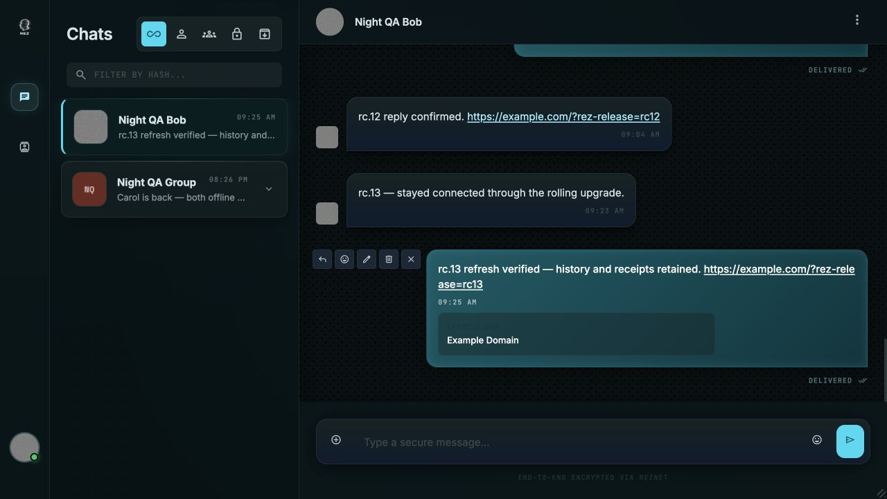

# RezNet crash repair and coordinated developer release — 2026-11-11

**Network repair, deployment, recovery and client acceptance: PASS.**
**Public GitHub prereleases: published. npm publication and anonymous GHCR pull: blocked on account setup.**

Release: **0.6.0-rc.13**, an experimental developer prerelease. The network
repair is independent of the unfinished iPhone, Swift and desktop work.

## Source and release boundaries

| Repository | Immutable release source | Scope |
| --- | --- | --- |
| Core | `b637c98` / `v0.6.0-rc.13` | Package version only; protocol implementation unchanged |
| SDK | `6e0ff11` / `v0.6.0-rc.13` | Coordinated dependency/version, packaged connection example and developer instructions |
| Node | `73f2bbe` / `v0.6.0-rc.13` | Peer-auth crash/recovery, coordinated release gates, container/CLI packaging |
| Chat | `67f8c69` | Deployment image and explicit backend package-manifest mount only |

[Core release](https://github.com/rezprotocol/rez-core/releases/tag/v0.6.0-rc.13),
[SDK release](https://github.com/rezprotocol/rez-sdk/releases/tag/v0.6.0-rc.13),
[Node release](https://github.com/rezprotocol/rez-node/releases/tag/v0.6.0-rc.13).
The final runtime comes from immutable tags and clean source archives. Every
packaged source file was compared with those archives; private-file scans passed.
No dirty working-copy code was used to build the image or packages. Source was committed
and pushed on `feat/hosted-cluster`; release tags/prereleases were published. This
task did not merge the feature branch into `main`. The final documentation commit
is separate from the tagged runtime source.

The earlier rc.11 and rc.12 tags were preserved. rc.11 exposed Windows command
wrapper execution and ambiguous npm tarball paths. The downloaded rc.12 macOS
CLI exposed a physical-path versus alias-path entry-point comparison. rc.13
corrects these packaging issues without further protocol changes. The builder
checks exact version output and a real POSIX symlink before archiving. All
requested release assets must exist; the scanner report uses its actual path.

## Crash and repair

The hosted node crashed at `2026-11-11T04:52:10Z` when a relay closed during peer
authentication. The auth rejection had no observer while the hello write was
pending. The old source reproduced that exact fatal error in an isolated child
with strict unhandled-rejection handling.

The pool observes write and authentication together, shares registration
readiness across concurrent callers, keeps authentication bounded through
acceptance, settles pending work on shutdown, and retires only the connection
generation it owns. TCP error, close, idle retirement and shutdown use one
idempotent retirement path. Late dials are destroyed after shutdown; late close
callbacks cannot remove a replacement. No global rejection suppression, TLS
bypass, authentication downgrade, new wire shape or database migration was added.

Detailed changed-code audit: [NETWORK_CRASH_FIX_2026-11-11.md](NETWORK_CRASH_FIX_2026-11-11.md).

## Verification

[Final coordinated CI run](https://github.com/rezprotocol/rez-node/actions/runs/43045465826).
Its overall conclusion is **failure solely because npm publication lacks
authentication**. The six independent verification/container/platform jobs pass.
Do not describe the whole run as green.

| Gate | Result |
| --- | --- |
| Core full suite | 582 passed, zero failed/skipped |
| SDK full suite | 549 passed, zero failed/skipped |
| Node full suite with real PostgreSQL, Redis, TLS and mesh fixtures | 1,408 passed, zero failed/skipped |
| Final-image destructive recovery | Five passed, zero failed/skipped |
| Focused network, CLI and version checks locally | 34 passed, zero failed/skipped |
| Chat compatibility on clean existing application source | 1,118 passed; three gated native integrations not run |
| Chat portability checks | Two passed |
| Linux x64, Windows x64, macOS arm64 and x64 CLI builds | Passed; version smoke tests passed |
| Downloaded public macOS arm64 CLI | Exact version through physical path, `/tmp` alias and symlink |
| Trivy scan of the exact final image | Zero HIGH/CRITICAL findings |
| Final runtime versus source tags | 631 application files match |
| Deployed runtime versus tested image | All six instances: 932 files and three workspace links match per instance |
| Fresh public Core/SDK archive install | Passed; both package contents match tags |
| Public packaged SDK authentication | Passed; authenticated status against hosted and portable entry points |
| Same-client packaged SDK reconnect | Passed before and after disconnect/connect, same identity |
| Public relay TLS and pinned peer authentication | Passed across all three relays |
| Signed-record custody and cross-relay retrieval | Passed, exact signed record retrieved |
| Final monitored live soak | Ten minutes: 256/256 acknowledged, 52 reconnects, 25 isolation checks, zero failures |

The five destructive checks use disposable containers, not real users' nodes:
non-sticky delivery/cursors/isolation; killing both node processes; Redis loss
with durable replay; PostgreSQL blackhole/restart with readiness failure; and
backup restoration into another database with bytes, cursors and isolation
preserved. Final-image CI repeats this proof before publication.

## Deployment and operation

Final activation: **PASS**, all three hosted node instances, all three public
relays and the preview backend run rc.13. All six identities match the originals.
The last monitoring sample completed at `2026-11-11T15:32:41Z`; there were no unexpected
restarts, OOM kills or failed readiness samples during the recorded windows.

Final image archive SHA-256:
`b3b1de3ec16044e8571e06ff5191559e2af0f75cd5124a46a3f8ddb228503a14`.
The hosted Docker engine records image ID
`sha256:343ce9e9643884d3c57d5e4f10ed1c66b1142714204f5f67de958be626fed29d`.
The image source label is `73f2bbe9a6e579d3b92d2d327dfb743033070cd7`.
The full runtime-file comparison avoids relying only on an image tag.

Both live traffic soaks passed separately, with both PG node identities reached:

| Phase | Traffic | Reconnects | Tenant checks | Worst delivery-and-ack round trip |
| --- | --- | --- | --- | --- |
| rc.12, 20 minutes | 509 sent / 509 acknowledged | 102 | 50 | 1,199 ms |
| Final rc.13, 10 minutes | 256 sent / 256 acknowledged | 52 | 25 | 453 ms |

Each phase verifies exact ciphertext bytes, live wakeups, shared durable cursors
and no redelivery after acknowledgment. These are separate phases, not one
uninterrupted 30-minute run. Across both phases, 113 server-monitor samples
passed. The final public metrics check returned 404; proxy/renewal-hook syntax
checks passed; the targeted fatal-log scan found zero matches.

Deployment retains identities, persistent volumes, authentication/encryption
configuration, TLS, proxy security headers and existing application assets.
Each node is rolled individually with before/after identity comparisons,
protected backups and a retained rollback runtime. The public Ubuntu relays
reuse the existing glibc Node `v24.22.2` executable with the tested application's
complete JavaScript dependency graph. The Alpine container executable is not
copied onto Ubuntu. No operating-system upgrade was required for this source cut.

The initial rc.12 rollout observed an HTTP 502 and automatically rolled back.
The proxy already refreshes Docker DNS every ten seconds; the rollout checked
routing before its address cache had refreshed. The corrected procedure reloads
the validated proxy configuration gracefully after each healthy replacement and
uses bounded route retries before continuing. The retry succeeded. No proxy
security rule or authentication setting was weakened.

Fresh database dumps were checked with `pg_restore --list`. Per-node filesystem
snapshots, previous image aliases, service drop-ins and private configuration
remain on their own servers, under protected release/backup directories. No
production secret or plaintext backup was downloaded or committed.

DigitalOcean reports daily backups enabled for hosted droplet `592168339`.
Backup `254103467`, created `2026-11-11T08:14:00Z` (7.76 GiB), is available. The
next window is `2026-11-12T08:00:00Z`–`12:00:00Z`. This confirms the first backup
completed; this task did not restore the DigitalOcean disk image into production.

## Client acceptance

The existing public web index remains SHA-256
`17fd725fabece4e245f37a411dce14754baa85d99302fdc9fcbc99c7dbad7f09`.
The preview backend uses the released image and an explicit read-only mount of
its committed Chat package manifest. No new desktop GUI, iPhone or Swift build
was produced.

Two existing synthetic browser accounts unlocked, displayed their retained
history and avatars, exchanged text/replies with `DELIVERED` status, and rendered
an outgoing URL preview. After the final rollout, the existing Bob tab recovered and sent normally;
Alice refreshed, unlocked without deleting site data, retained history/images,
and exchanged another delivered message and preview. Both existing 700×700
image elements loaded after refresh.



A fresh image upload was **not** proved by this browser session: the automation
file chooser could not address the transient input after the app removed it.
Existing images rendered and the earlier unchanged-client image proof is retained
in the Chat QA report. This is not reported as a new image-delivery pass. The
full Chat compatibility and image recovery/status tests passed as recorded above.
The native desktop GUI integrations remain untested in this task; their existing
release hold is not lifted.

## Public developer use and publishing limits

Use Node 24 and the matching public archives in a fresh app:

```sh
npm install https://github.com/rezprotocol/rez-core/releases/download/v0.6.0-rc.13/rezprotocol-core-0.6.0-rc.13.tgz https://github.com/rezprotocol/rez-sdk/releases/download/v0.6.0-rc.13/rezprotocol-sdk-0.6.0-rc.13.tgz
node node_modules/@rezprotocol/sdk/examples/connect.mjs
```

The example uses a disposable development identity. Real applications must keep
keys in protected local storage and handle connection lifecycle changes. The
[SDK README](https://github.com/rezprotocol/rez-sdk/blob/v0.6.0-rc.13/README.md)
contains the app-facing entry points and example.

**npm remains unpublished.** Local `npm whoami` returned E401, no publishing
credential is configured in the repositories, and the final npm job failed with
ENEEDAUTH. A maintainer must complete npm login/publisher setup. No password or
token is requested in chat. Plain `npm install @rezprotocol/sdk` is not the
verified install route yet.

**GHCR anonymous pull remains unavailable.** The image is pushed, deployed and
released as public `node-image.tar.gz`; an anonymous registry-token request
returned 401. The current maintainer CLI token has no package-management scope.
GitHub separates container visibility from repository visibility; see
[its package visibility documentation](https://docs.github.com/en/packages/learn-github-packages/configuring-a-packages-access-control-and-visibility).
Use the public Node release archive and `docker load --input node-image.tar.gz`
until package visibility is changed by a package administrator. No broader
credential permissions were created for this task.

## Focused audit and completion inventory

Files changed: Core `package.json`; SDK `package.json`, `README.md`,
`examples/connect.mjs`; Node `package.json`, release lock, public `Dockerfile`,
coordinated release workflow, SEA/version/proof scripts, CLI entry-point guard,
`RelayConnectionPool`, `TcpConnectionManager`, their tests, version-consistency
test and hosted/crash/release documentation; Chat
`deploy/compose.web-previews.yml`. The three superseded independent release
workflows were removed.

Specs checked: `AGENTS.md`; Node hosted design and public deployment contract;
existing relay identity/authentication invariants and tests; CLI behavior;
package export/version declarations; SDK connection lifecycle; Chat deployment
and existing bridge/client compatibility tests. No new protocol or RPC schema.

Canonical owners confirmed: Core owns signed vocabulary/crypto, Node owns
networking/authentication/runtime/release orchestration, SDK owns the app-facing
client, Chat owns the preview application service, and UI/native work stays in
its existing boundaries. No transport directive enumeration or extra facade.

Duplicate/split-brain findings: duplicate release workflows and socket retirement
paths removed. One registration promise coordinates concurrent callers. No new
protocol/message path or parallel owner was introduced.

Boundary/SSOT findings: none introduced in changed code/direct dependencies.
TLS pins, challenge nonces, signatures, generic transport dispatch and storage
ownership remain intact. Passing tests were not used to excuse a boundary change.

God-class findings: none in the changed surface; lifecycle logic remains in the
existing pool/manager rather than adding process-wide error policy. No new god
module or mixed UI/network owner.

Dead code removed: superseded release workflows and the nonexistent directory
launcher reference; old serial/unobserved auth handling and duplicate socket
retirement paths were replaced.

Tests added/updated: strict production-crash child repro; concurrent registration
failure/reconnect; complete authentication deadline; shutdown settlement; stale
socket replacement and late dial teardown; version/dependency coherence; real
packaged CLI output and POSIX symlink acceptance. Existing complete suites and
recovery tests run with their actual backend prerequisites.

Original tracked/untracked work-in-progress preservation: **PASS**. Original
tracked diffs match the initial hashes in all four repositories; all ten original
untracked files match their initial hashes. iPhone, Swift, storage/native and
unrelated desktop work was neither staged nor shipped. Only the two task-owned
disposable Docker fixture projects and their volumes were removed.

The [machine-readable acceptance receipt](verification/network-release-2026-11-11/acceptance.json)
and bounded evidence files in that directory retain exact checks, source commits,
soak diagnostics, runtime comparisons and publishing limitations. Production
backup contents and credentials are excluded.

Remaining risks: this is a bounded small-network developer acceptance run, not a
capacity or adversarial security certification. The hosted account-home database
and Redis still share one machine; relays do not make that database highly
available. Daily disk backups and logical restoration provide recovery. CLI archives are developer prereleases, not newly notarized desktop installers. Three
native GUI integration gates and a fresh browser image upload are explicitly
unverified here. npm authentication and container public visibility remain the
two publishing follow-ups. Use test data for experimental SDK development.
